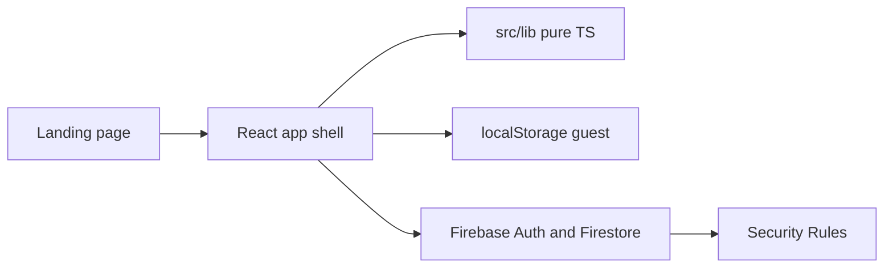

# Focus Plan M3E

Build on the existing private repo [Anonyoumss/Focus-Plan](https://github.com/Anonyoumss/Focus-Plan) (AI Studio export, local-only Zustand app). Do not start a second app. Clone it to `/home/nothingos/Focus-Plan` and move the workspace there before any edits.

Tomato (`nsh07/Tomato`) is **GPL-3.0**. Pomofocus.io is a commercial product; [bermarte/pomofocus](https://github.com/bermarte/pomofocus) is a partial MIT student timer, not the real site. Study both for behavior only. Write original TypeScript. Do not copy their source, assets, or copy.

Browsers do not expose the Chrome theme to pages. Theme follows `prefers-color-scheme` (System / Light / Dark) plus a user seed color through `@material/material-color-utilities`, and `theme-color` stays in sync. Record that limit in [DECISIONS.md](DECISIONS.md).

## What already exists

Local timer, tasks, test catalog, streaks, coins, settings, EN/AR strings, and screen shells. [FEATURE_PARITY.md](FEATURE_PARITY.md) marks almost all of this **Done** with no browser proof. Friends, the public board, and the store are local UI. There is no Firebase, no `@material/web`, no `anime.js`, no Playwright, no landing page, no `AGENTS.md`, and no `CONTRIBUTING.md`. `@google/genai` and `GEMINI_API_KEY` are present and must leave the client.

## Architecture

- UI: React 19 + Vite. Add `@material/web` for buttons, text fields, dialogs, switches, lists, menus, and navigation. Keep the custom timer, wavy ring, and charts where Material Web has no equivalent.
- Motion: `motion` for springs and layout. `anime.js` for the ring morph and the landing timeline. Honor `prefers-reduced-motion`.
- Tokens: full `--md-sys-color-*`, type, shape, elevation, and motion custom properties. Roboto Flex for the timer and headlines, Plus Jakarta Sans for Latin body, Readex Pro for Arabic. Material Symbols Rounded only. Varied shape scale, not one radius on every surface.
- Logic stays in framework-free [src/lib](src/lib) with Vitest: timer, streaks, goal percent, scheduling, points, coins, score progress.
- Charts: original SVG, flat M3 tonal fills, labels or patterns, no gradient area fills and no color-only encoding.
- Guest data stays in `localStorage`. First Google sign-in migrates it. Offline writes use Firestore persistence.

## Product rules to implement for real

- Categories such as Work, School, Extracurriculars, Study, Standardized tests, plus custom. Each task has min and max, and a cadence: hourly, daily, weekly, or monthly.
- A finished focus session can be tied to a task or a topic. Topics keep their own durations, the way Tomato does.
- Streak starts and continues only with 3 or more finished pomodoros in a local day, on any tasks. Missed day consumes a streak freeze if one is owned.
- Badges from goal percent (4 planned and 8 done is 200%), streak milestones, and score progress against the target.
- Test catalog: Saudi GAT, SAAT, STEP, KFUPM Early SAAT, plus SAT, ACT, IELTS, TOEFL, Duolingo, and custom. Sections and dates are editable. Every official date is labeled "verify on the official site". After a trial, the user logs a real score and sees progress toward the section targets.
- Reminders while the app is open use the Notifications API. Terms will say scheduled push and Calendar reminders are not shipped yet.
- Groups: invite code and link, member list, one shared task, ranking by weekly minutes, then focus points, then streak. Daily longer-study award is 1 focus point. Weekly leader award is 7. Spark fallback: the first member to open the app after the boundary writes a create-only ledger id (`groupId_day_YYYY-MM-DD`, `groupId_week_YYYY-Www`) inside a transaction.
- Profiles show only fields that member turned on. Hidden fields are a separate public projection. The viewer never receives the private user document.
- Opt-in public leaderboard.
- Store: streak freeze and a break multiplier (next long break becomes 30 minutes). Wallet and inventory are not free-form client writes. Rules check old balance, catalog price, and a matching ledger row in the same transaction.
- Sample tasks and any fake social rows are labeled demo data, or removed once real accounts exist.

## Milestones

Each milestone ends with lint (`tsc`), unit tests, production build, and a commit. UI milestones also get Playwright screenshots.

1. **Audit.** Read the repo and the four docs. Add [AGENTS.md](AGENTS.md) from the rules you supplied. Run install, typecheck, tests, and build. Add Playwright. Screenshot every route in English and Arabic, light and dark, 360px and 1280px, under `docs/screenshots`. Rewrite parity with only: Verified in browser, Unit tested only, Compiled only.
2. **Fix the shell.** Token and color violations, logical CSS for RTL, skeleton loaders, empty states, chart styling, accurate Terms and Privacy, demo-data labels. Landing page at `/` with a real timer preview, not a marketing template. App at `/app`. Footer links to real Terms and Privacy. Remove client Gemini. Add `anime.js`. Use `@material/web` on forms, dialogs, and settings controls without a wholesale rewrite.
3. **Firebase Spark.** Auth (Google), Firestore, App Check placeholder, emulator, rules tests, guest migration, offline persistence. Replace `.env.example` with the public web config keys only. Document the Firebase project values and authorized domains you must add, including the GitHub Pages host. No Cloud Functions.
4. **Social and store.** Groups, privacy projection, public board, point awards, rule-enforced wallet. Emulator tests plus Playwright with two simulated users.
5. **Remaining study tools.** Task edit after create, templates, JSON and CSV import/export, sounds, shortcuts, weekly and monthly CSV and PDF (Arabic and dark), editable test sections. Only fill what the audit shows is missing or unverified.
6. **Publish.** Update [README.md](README.md) and [CODEBASE.md](CODEBASE.md) so they match the code. Embed the Playwright screenshots. Add [CONTRIBUTING.md](CONTRIBUTING.md) and issue templates for bugs, improvements, and suggestions. Make `Anonyoumss/Focus-Plan` **public** so free GitHub Pages and outside pull requests work. Add a Pages workflow for the Vite `dist` output with `base: '/Focus-Plan/'` and an SPA fallback.

Capacitor, Google Tasks, Google Calendar, Gemini, and FCM stay documented as later work and are not built in this pass.

## What you will need at the Firebase step

A free Firebase project with Google sign-in enabled, the web app config copied into `.env.local`, and these authorized domains: `localhost` and `anonyoumss.github.io`. No Blaze plan.
