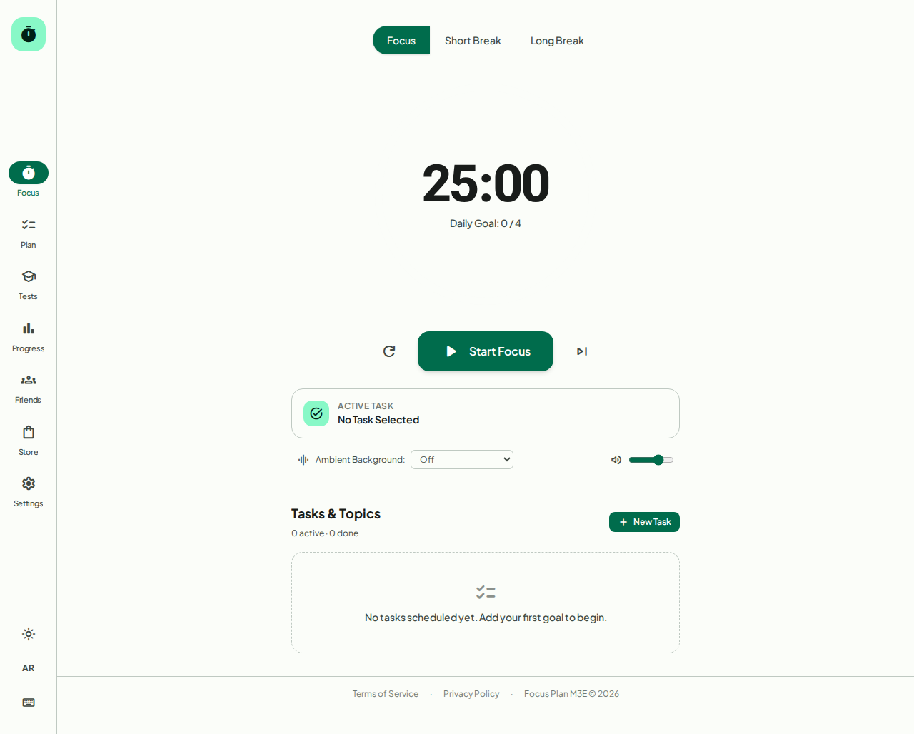
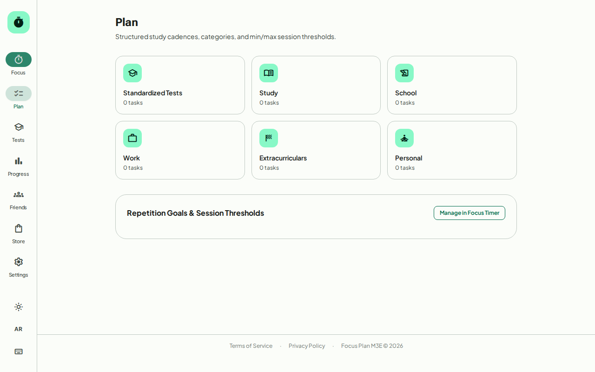
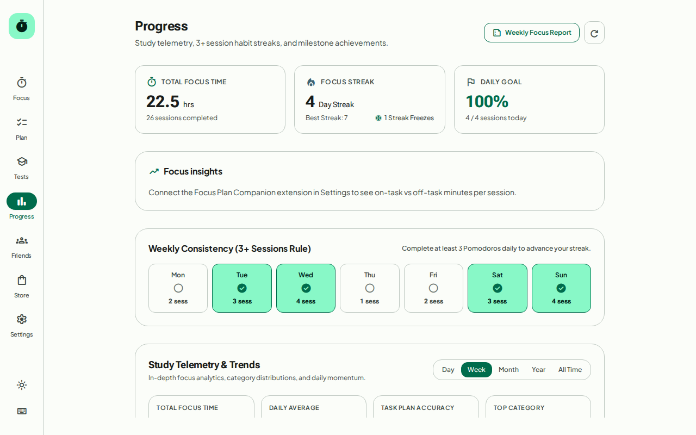
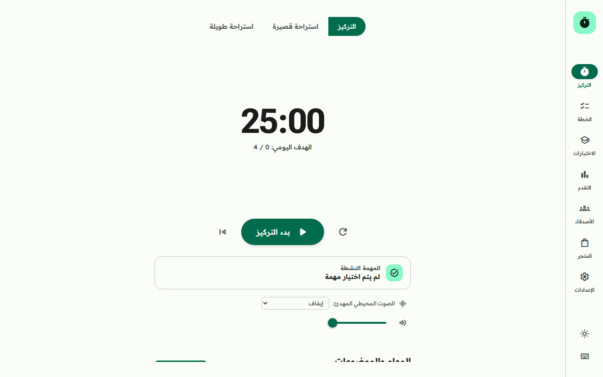
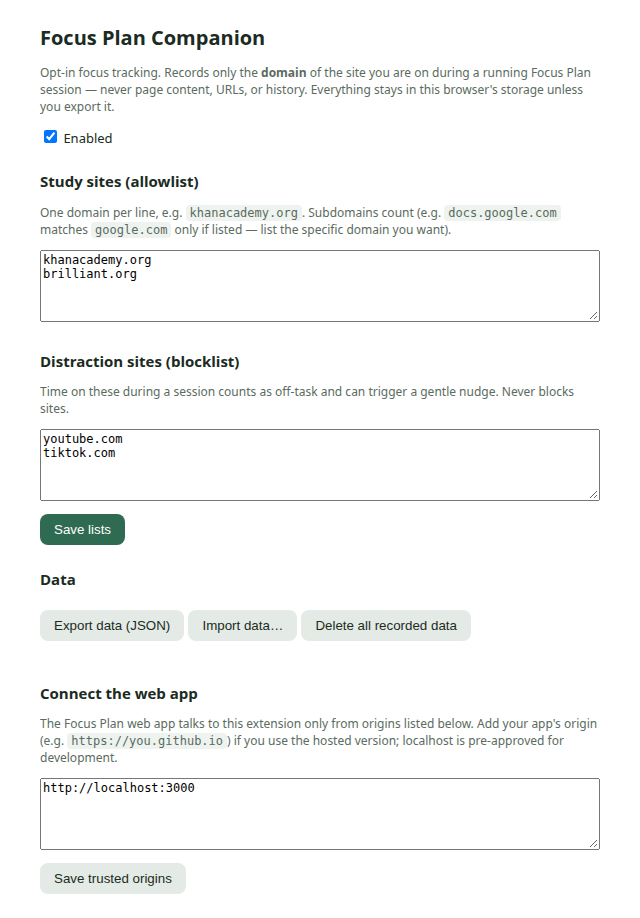

<div align="center">

# Focus Plan M3E

**A Pomodoro timer and goal-driven study tracker for standardized tests — English & Arabic, installable PWA, Android app, and browser extension.**

[](https://github.com/Anonyoumss/Focus-Plan/actions/workflows/ci.yml)
[](https://github.com/Anonyoumss/Focus-Plan/actions/workflows/android.yml)
[](https://github.com/Anonyoumss/Focus-Plan/actions/workflows/extension.yml)
[](https://github.com/Anonyoumss/Focus-Plan/actions/workflows/deploy.yml)
[](LICENSE)
[](https://firebase.google.com/pricing)

**[Live app](https://anonyoumss.github.io/Focus-Plan/)** · **[Releases (APK + extension)](https://github.com/Anonyoumss/Focus-Plan/releases)** · **[Report a bug](https://github.com/Anonyoumss/Focus-Plan/issues/new?template=bug_report.md)**

</div>

---

Focus Plan M3E merges Pomodoro-style focus timing with a study layer built
around your actual goals: tasks with session targets and repeat cadences,
a catalog of standardized tests with per-section score targets, streaks,
coins, badges, friends and groups — all in English and Arabic with full RTL,
Material 3 Expressive styling, and a real offline service worker.

It ships three ways from one codebase:

| Surface | What it is | Status |
|---|---|---|
| **Web / PWA** | Installable web app, offline-capable | [Live on GitHub Pages](https://anonyoumss.github.io/Focus-Plan/) |
| **Android** | Capacitor wrapper of the same web build | [Debug APK in Releases](https://github.com/Anonyoumss/Focus-Plan/releases) |
| **Browser extension** | Optional on/off-task tracker for focus sessions | [Chrome + Firefox zips in Releases](https://github.com/Anonyoumss/Focus-Plan/releases) |

## Screenshots

<div align="center">

| Focus timer | Plan | Progress |
|---|---|---|
|  |  |  |

| Tests | Arabic (RTL) | Settings |
|---|---|---|
|  |  |  |

</div>

The Android app renders this same UI inside a Capacitor WebView — see
[docs/ANDROID.md](docs/ANDROID.md). The extension's options page:



## Features (what actually exists today)

- **Focus timer**: focus / short break / long break modes, animated wavy
  SVG progress ring, Start/Pause shape morph, keyboard shortcuts,
  reload recovery, exactly-once session completion, screen wake lock,
  Web Audio chimes, ambient sound, optional tick sound.
- **Tasks**: categories, min/max session goals, cadences
  (hourly/daily/weekly/monthly), drag + keyboard reorder, edit, templates
  (single task or whole list, cloud-synced), JSON/CSV import and export
  with validation.
- **Standardized tests**: catalog for GAT, SAAT, STEP, KFUPM Early SAAT,
  SAT, ACT, IELTS, TOEFL, Duolingo, plus custom tests. Editable sections
  (add/rename/remove, score ranges, targets), score history, score-loop
  gap analysis with per-section percent-of-goal, history chart vs goal
  line, and an adjustable weekly plan recommendation. Post-test-date
  "log your score" prompt. Catalog entries carry "verify on official
  site" labels where data is unconfirmed.
- **Streaks & economy**: streak requires 3+ focus sessions per local
  day, streak freezes, focus coins, focus points, badges, inventory,
  store items. Wallet balances are rule-enforced via ledger transactions
  when signed in.
- **Groups (signed in)**: create/join by 6-char code or invite link,
  shared group task, member roster, shared session minutes,
  day/week leaderboards (minutes → focus points → streak), group daily
  (+1 FP) and weekly (+7 FP) awards claimed idempotently on app open.
- **Profiles & public board (opt-in)**: private profile plus a public
  projection containing only fields the member enabled; opt-in public
  leaderboard (alias, weekly minutes, streak). Stats refresh when the
  member opens the app.
- **Reports**: weekly and monthly summaries — total focus time,
  sessions, daily breakdown table, streak, points per category, task
  completion, test-goal progress. Older periods reachable. CSV export
  (UTF-8 BOM) and print-to-PDF.
- **Reminders (in-app only)**: while the app is open, browser
  Notifications for daily-goal tasks and upcoming test dates, with
  quiet hours and a permission flow. No background push — scheduled
  delivery is not shipped.
- **Bilingual**: English and Arabic, full RTL, logical CSS properties.
- **PWA**: installable manifest with PNG/maskable/Apple icons, service
  worker (`public/sw.js`) that precaches the full app shell (asset list
  emitted as `precache.json` at build time) so the app, timer and tasks
  work offline after one online visit, plus an update-available prompt.
  Hash routing (`#/`, `#/app/*`, `#/terms`, `#/privacy`, `#/invite/<code>`).
  Verified by `e2e/prod-pages.spec.ts`.

## Downloads

GitHub Releases carry the installables, built by CI on every `v*` tag:

- **Android**: `app-release.apk` (signed, when keystore secrets are set) or
  `app-debug.apk`. See [docs/ANDROID.md](docs/ANDROID.md).
- **Extension**: `focus-plan-companion-chrome.zip` and
  `focus-plan-companion-firefox.zip`. See [docs/EXTENSION.md](docs/EXTENSION.md).

## Browser extension (optional)

`extension/` is a Manifest V3 companion that records **domain-level**
on-task/off-task minutes while a focus session runs — never page content,
URLs, or history, all stored locally on your device. The app shows a Focus
insights card and a Settings section; everything works without it.
Details and install steps: [docs/EXTENSION.md](docs/EXTENSION.md).

## Tech stack

React 19, TypeScript, Vite, Zustand-style store, Tailwind CSS 4,
`@material/web` + Material Symbols Rounded, `motion` (springs),
`anime.js` (SVG ring), Firebase JS SDK 13 (Auth + Firestore, optional),
Vitest, Playwright, `@firebase/rules-unit-testing`.

## Local setup

```bash
npm install
npm run dev        # http://localhost:3000
```

Checks:

```bash
npm run lint         # tsc --noEmit
npm run lint:eslint  # eslint
npm test             # Vitest unit tests
npm run build        # production build (base /Focus-Plan/)
npx playwright test  # browser e2e (emulator specs self-skip)
```

### Firebase emulators (for sync/groups work)

Requires **Java 21** (firebase-tools 15.x; Java 17 fails). No sudo
needed — a user-local JRE works:

```bash
# one-time: download Temurin JRE 21 to ~/tools/jdk-21.0.13+9-jre
JAVA_HOME=~/tools/jdk-21.0.13+9-jre PATH=~/tools/jdk-21.0.13+9-jre/bin:$PATH \
  npm run test:e2e:firebase   # auth+firestore emulators + Playwright
npm run test:rules            # Firestore Security Rules tests
npm run firebase:emulators    # emulators UI at http://127.0.0.1:4000
```

### Environment variables

Copy `.env.example` to `.env.local`. All optional — with none set the
app runs as a guest.

| Variable | Purpose |
|---|---|
| `VITE_FIREBASE_API_KEY` | Firebase web API key (public config) |
| `VITE_FIREBASE_AUTH_DOMAIN` | Auth domain |
| `VITE_FIREBASE_PROJECT_ID` | Project id |
| `VITE_FIREBASE_STORAGE_BUCKET` | Storage bucket |
| `VITE_FIREBASE_MESSAGING_SENDER_ID` | Sender id |
| `VITE_FIREBASE_APP_ID` | Web app id |
| `VITE_USE_EMULATORS` | `true` to use local emulators |

### Real Firebase project setup

1. Create a project on the **Spark (free) plan**.
2. Register a Web app; copy the config values into `.env.local`.
3. Enable **Google** sign-in provider.
4. Authorized domains: `localhost` and `anonyoumss.github.io`.
5. Publish `firestore.rules` in the Firestore Rules tab.
6. App Check (reCAPTCHA) is recommended before real users — placeholder
   only today.

## Deploying

Two static hosts from one codebase, selected by `DEPLOY_TARGET` in
`vite.config.ts`:

- **GitHub Pages** (project site): the deploy workflow builds with
  `DEPLOY_TARGET=pages` → base `/Focus-Plan/`. Enable Pages with
  Source: GitHub Actions; add the six `VITE_FIREBASE_*` repository
  variables (leave unset for a guest-only deploy). No `vercel.json`
  needed for Vercel — hash routing (`#/...`) never hits the server, so
  no rewrites are required.
- **Vercel**: import the repo, leave `DEPLOY_TARGET` unset → base `/`.
  Set the same `VITE_FIREBASE_*` env vars in the Vercel project if you
  want sign-in.
- **Local dev / preview**: `DEPLOY_TARGET` unset → base `/`.

Static hosts have no AI server: with `VITE_AI_API_URL` unset the AI
buttons show the labeled offline estimate. With `VITE_FIREBASE_*` unset
the build runs fully as a guest.

## Honest limits

- Group leaderboards, wallet deltas, and award claims are written by
  the client inside Security-Rule bounds — an **honor system, not
  cheat-proof** without Cloud Functions (see DECISIONS.md).
- Public leaderboard stats refresh when the member opens the app.
- Reminders only fire while the app tab is open; no push when closed.
- Sync is last-write-wins per record with `updatedAt` merge; offline
  edits survive pulls, but there is no conflict-resolution UI.
- Test catalog defaults for unverified exams are plausible placeholders
  labeled "verify on official site" — corrections welcome via the
  catalog issue template with an official source URL.
- Everything cloud-related is verified on emulators only; no production
  Firebase project is wired yet.

## Roadmap

Google Tasks API, Google Calendar API, Gemini via Firebase AI Logic,
FCM web push reminders, richer reports, AI-studio custom audio/referrals (Stage E, in progress elsewhere).

## Contributing

See [CONTRIBUTING.md](CONTRIBUTING.md). Please read [AGENTS.md](AGENTS.md)
for design and honesty rules. Security reports: [SECURITY.md](SECURITY.md).

Built with AI assistance (Google AI Studio, Cursor, Devin, Claude).
Plans and prompts are in `docs/`.

## Credits & licenses

Built with: React, TypeScript, Vite, Tailwind CSS, `@material/web`
(Apache-2.0), `@material/material-color-utilities` (Apache-2.0),
`motion` (MIT), `anime.js` (MIT), Firebase JS SDK (Apache-2.0),
Vitest (MIT), Playwright (Apache-2.0). Fonts: Roboto Flex, Plus Jakarta
Sans, Readex Pro (SIL Open Font License); icons: Material Symbols
Rounded (Apache-2.0). This project is MIT licensed — see [LICENSE](LICENSE).
No code, assets, or copy from Pomofocus or Tomato was used.
